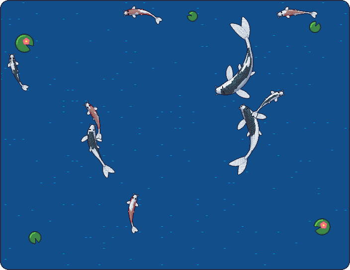

### Hi, I'm Rmanjini 👋

  

  <a href="https://github.com/Rmanjini/Rmanjini/issues/new?title=feed&body=Click+Create+to+drop+food+in+the+pond+%F0%9F%8D%9A"><b>🍚 Feed the koi</b></a> 
  <!-- fed -->Fed 1 time · last by @Rmanjini<!-- /fed -->

